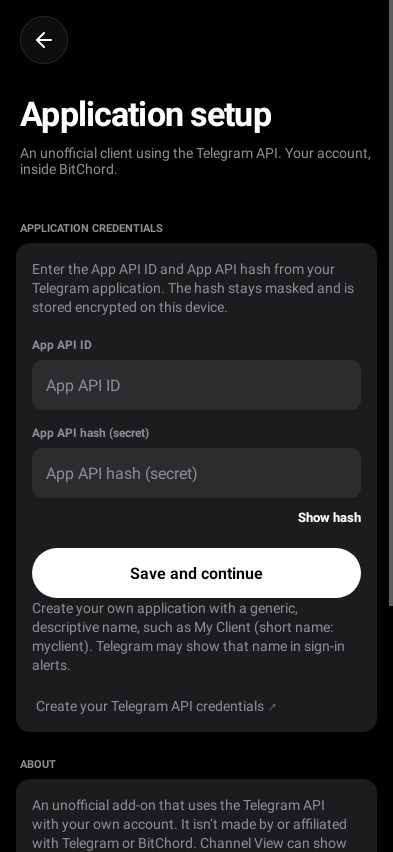
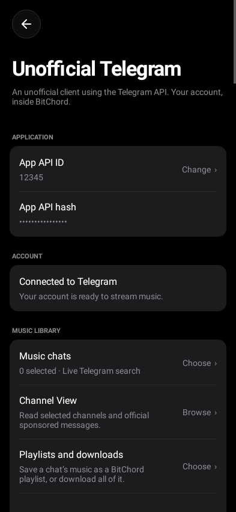
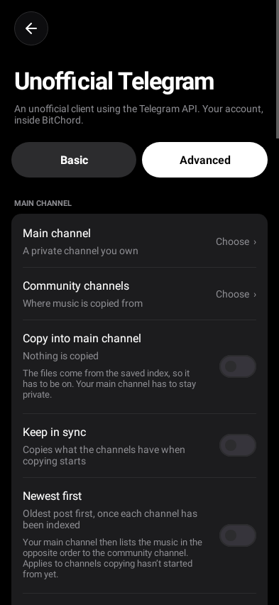
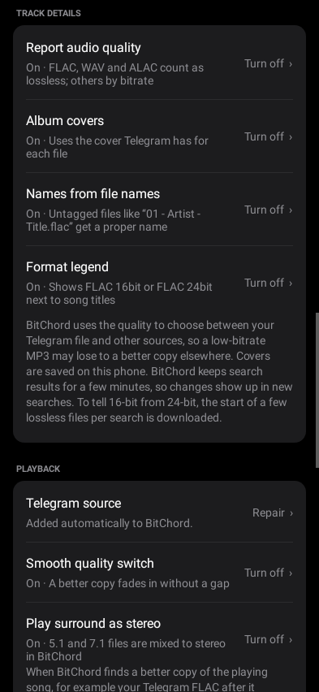
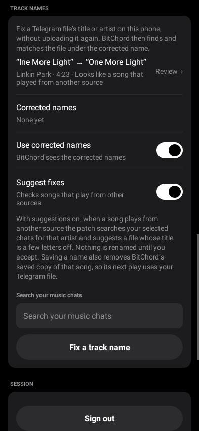

# BitChord Morphe Patches (Bitchord+)

> **Testing build 1.1.0-beta.9:** brings download tools and playback
> controls together under **Settings → Patches & tweaks**. Disabled features show
> only their compact row; enabling one opens its controls. Use its settings gear
> to reopen them later. Download formats now use switches and drag handles to set
> their preference order, following BitChord's Sources list.
> Optional Soulseek, paired-phone and Real-Debrid, AllDebrid, Premiumize and TorBox
> downloads retain the same Phone/Telegram/Both copy choices. See
> [download setup](docs/SOULSEEK-TESTING.md) and [debrid setup](docs/DEBRID.md).
> Download screens follow BitChord's selected language in all 20 supported translations.
> Screenshots and screen recording are enabled across beta.9 for UI review.
> Beta.9 adds quicker initial Soulseek results and opt-in discovery of compatible
> app peers. Discovery is under **Peer downloads → Connection setup → Peer discovery**;
> found public keys still require explicit pairing. See the [discovery guide](docs/PEER-DISCOVERY.md).
> The testing build still needs real-phone and public-network qualification.

[Morphe](https://morphe.software) patches for the [BitChord](https://github.com/kushagrasinghx/BitChord) Android music player. The main one, **Unofficial Telegram music**, lets BitChord search and play music from your own Telegram channels, in its original quality, entirely on your phone. No server, bot or hosting is involved.

**[Add this source to Morphe](https://morphe.software/add-source?github=Hexclyde/bitchord-morphe-patches&name=BitChord%20Morphe%20Patches&app=com.music.bitchord)** · [Releases](https://github.com/Hexclyde/bitchord-morphe-patches/releases) · [Setup guide](docs/MOBILE.md)

> **Status:** experimental (1.1.0-beta.9, a testing build). The combined patches target BitChord **1.9**. Check the [known limitations](docs/KNOWN_LIMITATIONS.md) before installing.
>
> The previous BitChord 1.8.1 Telegram integration was tested on an **arm64-v8a** phone; this 1.9 build still needs on-device testing. The armeabi-v7a and x86_64 builds pass the same automated checks, but haven't been run on a real device. The new Soulseek, paired-download and debrid features still need phone and public-network testing on all three architectures. Please [open an issue](https://github.com/Hexclyde/bitchord-morphe-patches/issues/new/choose) if you run into problems.

## Patches

| Patch | What it does |
| --- | --- |
| **Unofficial Telegram music** | Search and play audio from your own Telegram channels and chats through TDLib, using your own account. Android 8 or newer. |
| **Unofficial Soulseek audio** | Download selected Soulseek and paired-phone originals, plus optional debrid link downloads, with saved destination and format choices. Live playback from these sources is disabled. Android 8 or newer. |
| **Install as Bitchord+** | Installs next to your regular BitChord as **Bitchord+**, or under a name you choose. |
| **Sign in with MicroG** | Signs in to YouTube Music with an account that’s already in [MicroG RE](https://github.com/MorpheApp/MicroG-RE), instead of Google’s sign-in page. Only shows when MicroG RE is installed. |
| **Sing** | Turns the lead vocal down so you can sing over the song. Ported from [Auris](https://github.com/OreoMuncher45/Auris). Off by default. |
| **Pitch control** | Moves the key up or down without changing the speed. Off by default. |
| **Loudness level** | Sets how loud loudness normalisation plays songs. Off by default. |
| **Sleep timer fade-out** | Fades the song out before the sleep timer pauses it, and fades the end of the last song. Off by default. |
| **Battery saver** | Lets the phone's audio chip decode songs. Off by default. |
| **Lossless addons over Bluetooth** | Keeps lossless addons in use over Bluetooth, for all outputs or chosen ones. Off by default. |
| **Per-download quality** | Asks which quality to download each song in. Off by default. |
| **Headphone correction** | Flattens your headphones' sound with a measured profile from [AutoEq](https://github.com/jaakkopasanen/AutoEq), one per output. Off by default. |
| **Equaliser per output** | Remembers BitChord's equaliser for each output and shares settings as codes. Off by default. |
| **DJ mode** | Plays the queue in an order that mixes well, by key and tempo. Off by default. |
| **JamesDSP** | Hands BitChord's audio to [JamesDSP](https://github.com/timschneeb/RootlessJamesDSP). Off by default. |

More BitChord add-ons will be added to this repository over time.

<p>
  
  
  
  
  
</p>

## Unofficial Telegram music features

- Search your selected Telegram channels by title, artist or file name, from BitChord's **Addons** tab, picking them from any folder or your archive
- Stream and seek through the original files, with no transcoding
- FLAC, WAV, AIFF and ALAC are reported to BitChord as lossless, so it can prefer them over lossy copies
- Fake lossless files are caught: a FLAC made from an MP3 shows as **FLAC 16bit · from ≈128 kbps** and is ranked as that MP3, and upsampled or padded hi-res files show what they really are
- Album covers from Telegram in search results
- A saved index of your chats' music answers when Telegram's search is rate limited or busy
- Save a channel as a BitChord playlist, or download all of it
- Albums shared as zip files: every song inside is found, played and matched like any other file, without downloading the zip
- Albums kept as one FLAC or WAV file with a cue sheet: each track becomes its own song, played exactly from its start to its end
- A chat's albums, each to save as a playlist or download
- Back up and restore your settings, back up as you sign out and restore in one tap when you're back, and share a chat's index so friends in the same channel can skip indexing it
- Check by sound whether a Telegram file with a different length is the same recording as the song
- Copy music from community channels into a private channel you own, at a pace you set, with lossless-only and duplicate filters
- Untagged files get their title and artist from the file name (`03 - Artist - Title.flac`), or, with your free AcoustID key, by sound
- 5.1 and 7.1 files play as proper stereo, mixed inside the player without converting the file
- A small format legend next to song titles (FLAC 24bit, Dolby Atmos, DD+ 5.1, MP3 320kbps, …), in the main search too
- Dolby Digital, Dolby Digital Plus and Dolby Atmos files, with Atmos passed on to BitChord as Atmos
- When a better copy turns up mid-song, it fades in without a gap
- Fix misnamed files on your phone, with suggestions, without uploading them again
- Browse channel posts in Channel View
- Control the size of the Telegram audio cache
- See the playing source and bitrate in **Show stats for nerds**
- The patch pages in 20 languages, following BitChord's language setting: Spanish, Portuguese, French, German, Italian, Polish, Russian, Turkish, Arabic, Hebrew, Urdu, Hindi, Bengali, Thai, Vietnamese, Indonesian, Chinese (Simplified and Traditional), Japanese and Korean

Every extra (quality, fake lossless checks, covers, file names, naming by sound, format legend, smooth switching, surround mixing, sound checks, the saved index, the main channel copy, name fixes and suggestions) can be turned off in the app.

## Patches & tweaks

Install the features you want in Morphe, then open **Settings → Patches & tweaks**.
The page contains the installed download and playback features. Their
controls follow BitChord's theme, fonts, switches and rounded cards.

Each feature has an enable switch and settings gear. When off, its detailed
controls are hidden and its gear is disabled. Enabling a feature expands its
controls; opening another feature collapses the previous one without turning it
off. Tap an enabled feature's gear to review it again. Disabling a feature keeps
its saved settings for later. Existing explicitly chosen settings are retained
when updating. Telegram keeps its existing source toggle and settings page. The eleven optional
playback patches are:

- **Sing:** turns the lead vocal down so you can sing over the song, from a little to all of it. By default only the voice range is cut, only while someone is singing, and drum hits are left alone; **Whole centre** removes everything in the middle instead, which suits older recordings. Ported from [Auris](https://github.com/OreoMuncher45/Auris) by OreoMuncher45.
- **Pitch control:** up or down by up to 12 semitones without changing the speed. BitChord's speed setting keeps the pitch you set.
- **Loudness level:** how loud songs play with BitChord's loudness normalisation on, from -23 to -8 LUFS. BitChord's own level is -14 LUFS. It applies to the songs BitChord normalises, the ones YouTube gives a loudness for.
- **Sleep timer fade-out:** when the timer's time is up, the song fades out over a length you choose (3 to 60 seconds) before it pauses. With the timer's **After this song** option, the last seconds of that song fade instead of it stopping at full volume. A fade stands down the moment you play, pause, seek or set the timer again, and the volume comes back up for the next time you play.
- **Battery saver:** lets the phone's audio chip decode songs it can, so the processor can sleep during long listens. While a song plays this way, the equaliser, loudness normalisation, Sing, spatial audio and crossfade don't work on it. The page shows which formats your phone's chip can play and which decoder is in use now. The chip isn't asked for while Sing, Headphone correction, DJ mode or JamesDSP needs the decoded audio, and a changed speed or pitch is only handed over when the chip supports it. It stays off on the page until you turn it on.
- **Lossless addons over Bluetooth:** BitChord skips addons marked lossless while the phone can't output lossless audio, such as over Bluetooth. Allow them for every Bluetooth output, or only for the devices you pick from the ones you've connected; the page shows the codec in use. The phone then sends them with its best Bluetooth codec. It stays off on the page until you turn it on.
- **Per-download quality:** when you download a song, BitChord asks whether you want it in Standard, High or Lossless quality instead of always using the Download quality setting. An album asked for in one go is asked about once. The idea is from [Stash](https://github.com/rawnaldclark/Stash).
- **Headphone correction:** a parametric equaliser that flattens a headphone's own sound from a profile measured for that model. Search [AutoEq](https://github.com/jaakkopasanen/AutoEq)'s thousands of models by name, or paste any parametric EQ in Equalizer APO's text form. Each output keeps its own profile, so wired earphones and a Bluetooth headset each get theirs, and a strength slider scales it. Profiles are fetched from AutoEq's GitHub repository when you pick one and kept on the phone.
- **Equaliser per output:** BitChord's equaliser settings are remembered for each output (the speaker, wired, USB, each Bluetooth device) and put back when that output is in use again. Set the equaliser for the car with the car connected, for earbuds with the earbuds connected. A setting can be copied as a short code and pasted on another phone.
- **DJ mode:** the next song in the queue is chosen for a key next to the current one on the Camelot wheel and a close tempo, so songs mix well. Songs you queued yourself keep their place, and nothing moves in a Listen Together party. Each song's key and tempo are learned as it plays, and BitChord's own Automix analyses are used when it has them.
- **JamesDSP:** opens [JamesDSP](https://github.com/timschneeb/RootlessJamesDSP) from BitChord, announces BitChord's audio session to it again, and can hand the effects over: BitChord's equaliser goes off and Battery saver stands down, since a song on the audio chip can't be heard by JamesDSP.

Everything is at BitChord's own behaviour until you change it, and none of them needs the Telegram patch. Pitch control, Loudness level, Sleep timer fade-out, Headphone correction, Equaliser per output and DJ mode follow features of [Prism](https://github.com/Yigder/Prism) by Yigder; the code is written for BitChord.

## Requirements

- Android 8.0 or newer
- The original [BitChord 1.9 APK](https://github.com/kushagrasinghx/BitChord/releases) for the testing bundle (arm64-v8a, armeabi-v7a or x86_64)
- [Morphe Manager](https://github.com/MorpheApp/morphe-manager/releases)
- For Telegram features: a Telegram account and an API ID and hash from [my.telegram.org](https://my.telegram.org/apps)
- For optional debrid downloads: an enabled provider and your own account API key

## Quick start

1. [Add this source to Morphe](https://morphe.software/add-source?github=Hexclyde/bitchord-morphe-patches&name=BitChord%20Morphe%20Patches&app=com.music.bitchord). On the source card, enable **Experimental app versions**.
2. Patch the BitChord version supported by your selected source with **Unofficial Telegram music**, **Install as Bitchord+** and, if you like, **Sign in with MicroG** and any of the [tweaks](#patches--tweaks). Leave the API ID at `0` and the API hash empty.
3. Install the patched app and open **Settings → Account & integrations → Unofficial Telegram**.
4. Enter your API ID and hash, sign in, and pick your music chats.
5. Go to **Search → Addons** to find and play your audio.

Testing builds are separate from this source; see [Testing builds](#testing-builds).

If the source link doesn't work, download the `.mpp` from the [releases page](https://github.com/Hexclyde/bitchord-morphe-patches/releases) and add it as a Local source.

Step-by-step guides:

- [Installing with Morphe](docs/MOBILE.md)
- [Publishing the prepared beta.9 ZIP](docs/PUBLISHING-1.1.0-beta.9.md)
- [Connecting Telegram](docs/SETUP.md)
- [Optional debrid downloads](docs/DEBRID.md)
- [Compatible-peer discovery and peer exchange](docs/PEER-DISCOVERY.md)
- [FAQ](docs/FAQ.md)
- [Troubleshooting](docs/TROUBLESHOOTING.md)

## Testing builds

New versions go to a `testing` branch first, as GitHub pre-releases with versions like `1.1.0-beta.1`. The normal source above only gets a version once it's out of testing, whatever its **Pre-release patches** switch is set to.

To try a testing build, add a second source in Morphe with this URL and turn on **Experimental app versions** on it:

```text
https://raw.githubusercontent.com/Hexclyde/bitchord-morphe-patches/refs/heads/testing/patches-bundle.json
```

Use this exact link. Morphe changes other GitHub branch links to `main`, so they would give you the normal version.

Patch from the testing source, and turn the normal source off for that run so the patches aren't listed twice. When the version is released, you'll get it from the normal source as an update. To go back to the current release, remove the testing source and patch again from the normal one. You can also download a testing build's `.mpp` from its pre-release on the [releases page](https://github.com/Hexclyde/bitchord-morphe-patches/releases) and add it as a Local source.

## Privacy

The patch creates a normal Telegram client session on your phone. You can revoke it at any time in the official Telegram app under **Settings → Devices**. Your API credentials are encrypted with Android Keystore. More details are in [PRIVACY.md](PRIVACY.md).

## Disclaimer

**Use these patches responsibly.** They're free to use and provided as-is, without any warranty. I'm not responsible or liable in any way for what happens to your Telegram account or channels while you use them, including your account being limited or banned, or a channel being taken down.

By downloading, installing or using these patches, you accept these terms. If you don't agree with them, don't use them. The [GPL license](LICENSE) they're released under also says they come with no warranty.

This project doesn't provide any music. You're responsible for what you upload and play, so only use recordings you own or have permission to use. The patches don't unlock premium features or get around paid or protected content.

This is an independent project and isn't affiliated with BitChord, Telegram or Morphe.

## Contributing

Bug reports and pull requests are welcome. Read [CONTRIBUTING.md](CONTRIBUTING.md) first. Translation fixes go in `translations/<language>.json`; `python3 tools/translations.py` rebuilds the table the add-on reads. If you want to build from source, see [docs/BUILDING.md](docs/BUILDING.md).

## Credits

- [BitChord](https://github.com/kushagrasinghx/BitChord) by kushagra (kushagrasinghx) and its contributors, the app these patches are for.
- [Auris](https://github.com/OreoMuncher45/Auris) by OreoMuncher45, a fork of BitChord. Sing is ported from its vocal remover.
- [Prism](https://github.com/Yigder/Prism) by Yigder and [Stash](https://github.com/rawnaldclark/Stash) by Rawnald Clark, with Evo (ParaliyzedEvo). Their pitch, loudness, sleep fade, headphone correction, per-output equaliser, DJ mode and per-download quality features shaped the playback patches; no code was taken from them.
- [AutoEq](https://github.com/jaakkopasanen/AutoEq) by Jaakko Pasanen, whose headphone measurements Headphone correction fetches.
- [JamesDSP](https://github.com/timschneeb/RootlessJamesDSP) by Tim Schneeberger and [James Fung](https://github.com/james34602/JamesDSPManager), the effect engine the JamesDSP patch works with.
- [MicroG RE](https://github.com/MorpheApp/MicroG-RE) and [Morphe](https://morphe.software) by the Morphe team.

## License

[GPL-3.0-or-later](LICENSE). Bundled third-party components keep their own licenses. See [THIRD_PARTY_NOTICES.md](THIRD_PARTY_NOTICES.md).
